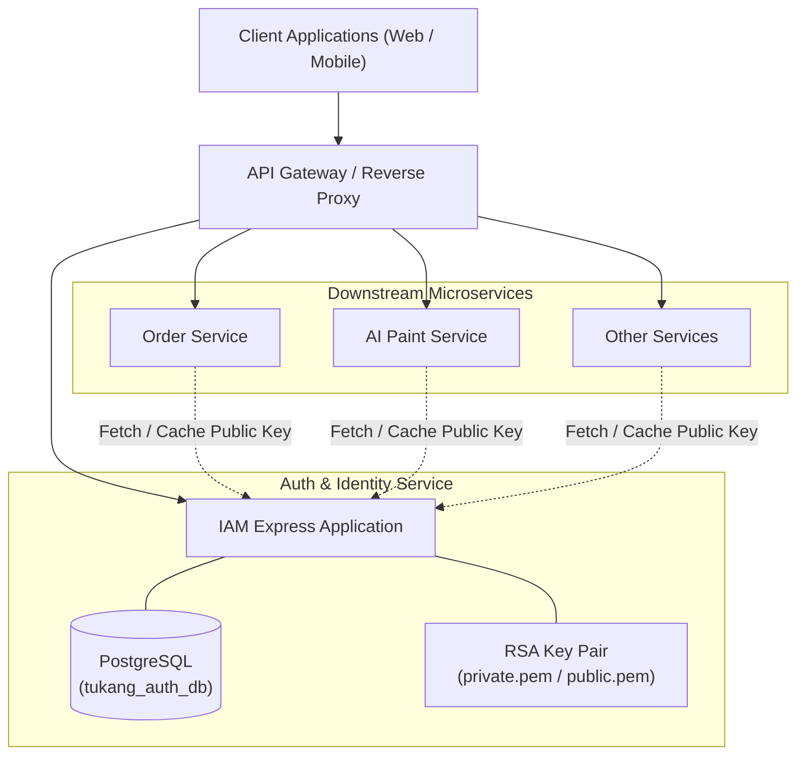
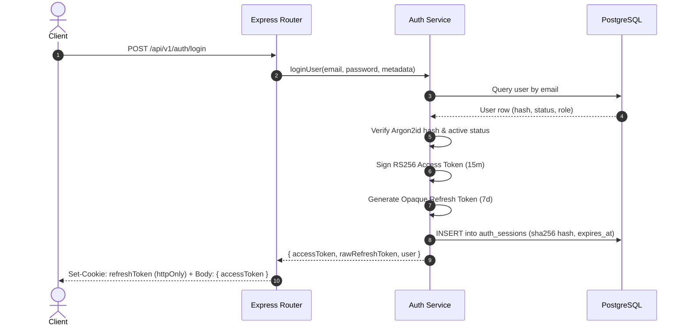
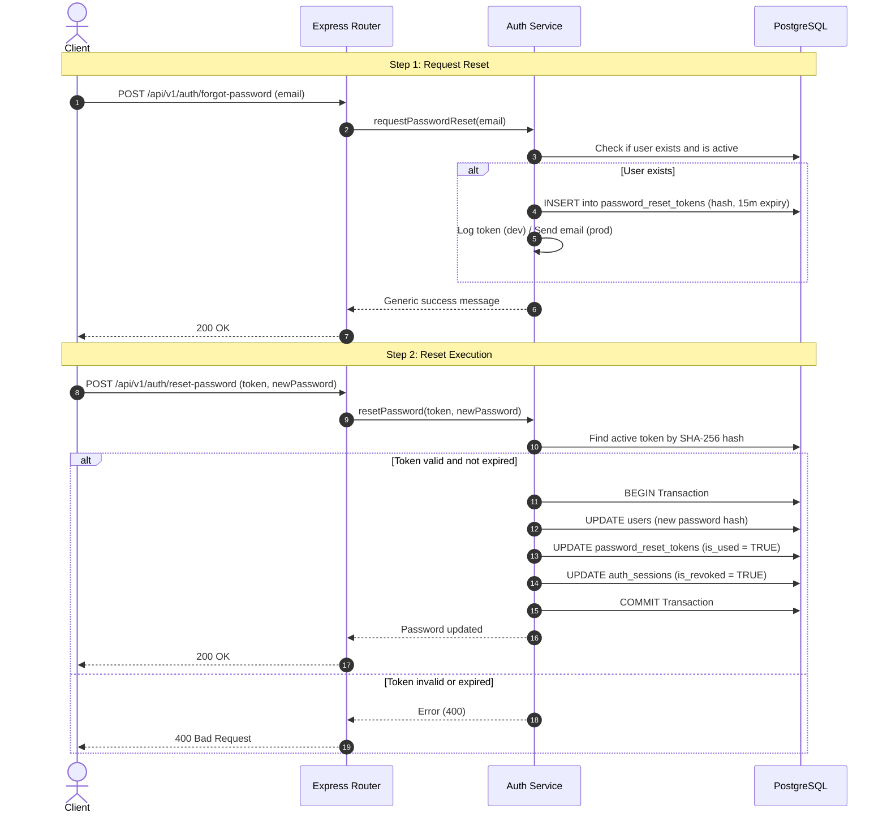

# Tukang Online - Auth & Identity Service (IAM)

Identity and Access Management (IAM) microservice for **Tukang Online**, an on-demand construction and home improvement platform. This service handles user authentication, role-based authorization, session lifecycles, and basic profile storage. 

It is designed following the Database-per-Service pattern and issues asymmetric RS256 JSON Web Tokens (JWT) so downstream services (such as Order Service and AI Paint Service) can independently verify client identities without querying the Auth database.

---

## Table of Contents

- [Architecture](#architecture)
  - [System Context](#system-context)
  - [Key Technical Decisions](#key-technical-decisions)
- [Authentication and Security Design](#authentication-and-security-design)
  - [Asymmetric JWT (RS256)](#asymmetric-jwt-rs256)
  - [Password Hashing (Argon2id)](#password-hashing-argon2id)
  - [Refresh Token Rotation (RTR)](#refresh-token-rotation-rtr)
  - [Password Reset Flow](#password-reset-flow)
- [Authentication Workflows](#authentication-workflows)
  - [Login and Session Issuance](#login-and-session-issuance)
  - [Forgot and Reset Password](#forgot-and-reset-password)
- [Database Schema (PostgreSQL)](#database-schema-postgresql)
  - [Data Model](#data-model)
  - [DDL Script](#ddl-script)
- [Project Structure](#project-structure)
- [API Documentation](#api-documentation)
  - [Health and Public Key](#health-and-public-key)
  - [Authentication](#authentication)
  - [Password Reset](#password-reset)
  - [Protected Resources](#protected-resources)
- [Setup and Installation](#setup-and-installation)
  - [Prerequisites](#prerequisites)
  - [Installation Steps](#installation-steps)
  - [Generating RSA Keys](#generating-rsa-keys)
  - [Environment Configuration](#environment-configuration)
  - [Database Setup](#database-setup)
  - [Running the Application](#running-the-application)

---

## Architecture

### System Context

In the Tukang Online platform, downstream business services require stateless verification of incoming user requests. The IAM service acts as the identity authority:



### Key Technical Decisions

- **Database-per-Service**: The IAM service owns the `tukang_auth_db` PostgreSQL database. No other service has read or write access to this database.
- **Layered Code Architecture**: The codebase is organized into Controllers (HTTP handling), Services (business rules), Repositories (database queries), Schemas (Zod validation), and Middlewares.
- **Stateless Verification**: Downstream services verify tokens locally using the public key exposed by the IAM service at `/api/v1/auth/public-key`.
- **Atomic Transactions**: Multi-table writes (such as user creation with corresponding role profiles, and password resets with session revocation) are executed within database transactions (`BEGIN` / `COMMIT` / `ROLLBACK`).

---

## Authentication and Security Design

### Asymmetric JWT (RS256)
- **Token Signing**: The service uses an RSA private key (`certs/private.pem`) to sign access tokens (15-minute expiration).
- **Token Verification**: Verification uses the corresponding RSA public key (`certs/public.pem`). Downstream services only need the public key, ensuring that a compromised downstream service cannot forge tokens.

### Password Hashing (Argon2id)
Passwords are encrypted using Argon2id with standard parameters:
- Memory cost: 64 MB (`2^16`)
- Time cost: 3 iterations
- Parallelism: 1 thread

### Refresh Token Rotation (RTR)
- Refresh tokens are 64-byte cryptographically secure random values (hex strings) stored inside an `httpOnly`, `secure`, and `SameSite=Strict` cookie.
- The database stores only the SHA-256 hash of the refresh token.
- When `/api/v1/auth/refresh-token` is invoked, the used token session is revoked (`is_revoked = TRUE`) and a new refresh token is issued immediately.

### Password Reset Flow
- **Anti-Enumeration**: Requesting a password reset returns a generic success message regardless of whether the email exists in the database.
- **Token Format and Expiry**: Generates a 32-byte cryptographic random token valid for 15 minutes. The database stores the SHA-256 hash.
- **Session Revocation**: Upon a successful password reset, all active refresh sessions for the user account are revoked across all devices.

---

## Authentication Workflows

### Login and Session Issuance



### Forgot and Reset Password



---

## Database Schema (PostgreSQL)

### Data Model

The service uses five tables within the `tukang_auth_db` database:

1. `users`: Credentials, account status, and role (`client`, `worker`, `contractor`).
2. `client_profiles`: Profile attributes for clients and contractors (1-to-1 with `users`).
3. `worker_profiles`: Professional details for workers including specialization and hourly rates (1-to-1 with `users`).
4. `auth_sessions`: Active refresh token records, hashed token values, expiration, and revocation status.
5. `password_reset_tokens`: Single-use tokens for password recovery.

### DDL Script

The full initialization script is located at [`database/schema.sql`](database/schema.sql):

```sql
CREATE EXTENSION IF NOT EXISTS "pgcrypto";

-- 1. users
CREATE TABLE IF NOT EXISTS users (
    id UUID PRIMARY KEY DEFAULT gen_random_uuid(),
    email VARCHAR(255) NOT NULL UNIQUE,
    password_hash VARCHAR(255) NOT NULL,
    role VARCHAR(20) NOT NULL CHECK (role IN ('client', 'worker', 'contractor')),
    status VARCHAR(20) NOT NULL DEFAULT 'active' CHECK (status IN ('active', 'suspended', 'deactivated')),
    is_verified BOOLEAN NOT NULL DEFAULT FALSE,
    created_at TIMESTAMPTZ NOT NULL DEFAULT CURRENT_TIMESTAMP,
    updated_at TIMESTAMPTZ NOT NULL DEFAULT CURRENT_TIMESTAMP
);

CREATE INDEX IF NOT EXISTS idx_users_email ON users (email);
CREATE INDEX IF NOT EXISTS idx_users_role ON users (role);
CREATE INDEX IF NOT EXISTS idx_users_status ON users (status);

-- 2. client_profiles
CREATE TABLE IF NOT EXISTS client_profiles (
    id UUID PRIMARY KEY DEFAULT gen_random_uuid(),
    user_id UUID NOT NULL UNIQUE REFERENCES users(id) ON DELETE CASCADE,
    full_name VARCHAR(100) NOT NULL,
    phone_number VARCHAR(20),
    address TEXT,
    created_at TIMESTAMPTZ NOT NULL DEFAULT CURRENT_TIMESTAMP,
    updated_at TIMESTAMPTZ NOT NULL DEFAULT CURRENT_TIMESTAMP
);

CREATE INDEX IF NOT EXISTS idx_client_profiles_user_id ON client_profiles (user_id);

-- 3. worker_profiles
CREATE TABLE IF NOT EXISTS worker_profiles (
    id UUID PRIMARY KEY DEFAULT gen_random_uuid(),
    user_id UUID NOT NULL UNIQUE REFERENCES users(id) ON DELETE CASCADE,
    full_name VARCHAR(100) NOT NULL,
    phone_number VARCHAR(20),
    specialization VARCHAR(100) NOT NULL,
    hourly_rate NUMERIC(12, 2) NOT NULL DEFAULT 0.00,
    years_of_experience INT NOT NULL DEFAULT 0,
    is_available BOOLEAN NOT NULL DEFAULT TRUE,
    created_at TIMESTAMPTZ NOT NULL DEFAULT CURRENT_TIMESTAMP,
    updated_at TIMESTAMPTZ NOT NULL DEFAULT CURRENT_TIMESTAMP
);

CREATE INDEX IF NOT EXISTS idx_worker_profiles_user_id ON worker_profiles (user_id);
CREATE INDEX IF NOT EXISTS idx_worker_profiles_specialization ON worker_profiles (specialization);

-- 4. auth_sessions
CREATE TABLE IF NOT EXISTS auth_sessions (
    id UUID PRIMARY KEY DEFAULT gen_random_uuid(),
    user_id UUID NOT NULL REFERENCES users(id) ON DELETE CASCADE,
    refresh_token_hash CHAR(64) NOT NULL,
    user_agent TEXT,
    ip_address VARCHAR(45),
    is_revoked BOOLEAN NOT NULL DEFAULT FALSE,
    expires_at TIMESTAMPTZ NOT NULL,
    created_at TIMESTAMPTZ NOT NULL DEFAULT CURRENT_TIMESTAMP,
    updated_at TIMESTAMPTZ NOT NULL DEFAULT CURRENT_TIMESTAMP
);

CREATE INDEX IF NOT EXISTS idx_auth_sessions_user_id ON auth_sessions (user_id);
CREATE INDEX IF NOT EXISTS idx_auth_sessions_token_hash ON auth_sessions (refresh_token_hash);
CREATE INDEX IF NOT EXISTS idx_auth_sessions_valid_lookup 
    ON auth_sessions (refresh_token_hash, is_revoked, expires_at);

-- 5. password_reset_tokens
CREATE TABLE IF NOT EXISTS password_reset_tokens (
    id UUID PRIMARY KEY DEFAULT gen_random_uuid(),
    user_id UUID NOT NULL REFERENCES users(id) ON DELETE CASCADE,
    token_hash CHAR(64) NOT NULL,
    is_used BOOLEAN NOT NULL DEFAULT FALSE,
    expires_at TIMESTAMPTZ NOT NULL,
    created_at TIMESTAMPTZ NOT NULL DEFAULT CURRENT_TIMESTAMP
);

CREATE INDEX IF NOT EXISTS idx_password_reset_tokens_user_id ON password_reset_tokens (user_id);
CREATE INDEX IF NOT EXISTS idx_password_reset_tokens_token_hash ON password_reset_tokens (token_hash);
CREATE INDEX IF NOT EXISTS idx_password_reset_valid_lookup 
    ON password_reset_tokens (token_hash, is_used, expires_at);
```

---

## Project Structure

```text
projek3_LoginSpesificUser/
├── certs/
│   ├── private.pem               # RSA Private Key (Signing)
│   └── public.pem                # RSA Public Key (Verification)
├── database/
│   └── schema.sql                # PostgreSQL DDL initialization script
├── src/
│   ├── config/
│   │   ├── database.js           # PostgreSQL pool configuration
│   │   └── keys.js               # RSA key certificate reader
│   ├── controllers/
│   │   └── auth.controller.js    # Request handlers & response formatting
│   ├── middlewares/
│   │   ├── auth.middleware.js    # JWT token verification and RBAC guards
│   │   ├── error.middleware.js   # Central error handling middleware
│   │   ├── rateLimiter.middleware.js # Express rate limit configuration
│   │   └── validate.middleware.js# Zod schema validation middleware
│   ├── repositories/
│   │   ├── passwordReset.repository.js # Password reset queries
│   │   ├── session.repository.js       # Auth session queries
│   │   └── user.repository.js          # User and profile queries
│   ├── routes/
│   │   └── auth.routes.js        # Route definitions
│   ├── schemas/
│   │   └── auth.schema.js        # Zod validation schemas
│   ├── services/
│   │   └── auth.service.js       # Core business logic
│   ├── utils/
│   │   ├── hash.util.js          # Argon2id and SHA-256 helpers
│   │   └── token.util.js         # JWT generation and validation helpers
│   ├── app.js                    # Express application setup
│   └── server.js                 # Server entry point
├── .env.example
├── package.json
└── README.md
```

---

## API Documentation

All authentication routes are prefixed with `/api/v1/auth`.

### Health and Public Key

#### `GET /health`
Liveness check endpoint.

```json
{
  "status": "success",
  "service": "tukang-iam-service",
  "timestamp": "2026-10-15T15:00:00.000Z"
}
```

#### `GET /api/v1/auth/public-key`
Returns the RSA public key in PEM format for downstream services to verify access tokens.

```text
-----BEGIN PUBLIC KEY-----
MIIBIjANBgkqhkiG9w0BAQEFAAOCAQ8AMIIBCgKCAQEA...
-----END PUBLIC KEY-----
```

---

### Authentication

#### `POST /api/v1/auth/register`
Creates a new account and associated profile. Rate limited to 10 requests per 15 minutes.

- **Request Body (Worker)**:
```json
{
  "email": "budi.tukang@example.com",
  "password": "Password123!",
  "role": "worker",
  "fullName": "Budi Santoso",
  "phoneNumber": "081234567890",
  "specialization": "Tukang Bangunan",
  "hourlyRate": 75000
}
```

- **Request Body (Client)**:
```json
{
  "email": "siti.client@example.com",
  "password": "Password123!",
  "role": "client",
  "fullName": "Siti Rahma",
  "phoneNumber": "081987654321"
}
```

- **Response (`201 Created`)**:
```json
{
  "status": "success",
  "message": "Registrasi berhasil",
  "data": {
    "user": {
      "id": "e2f47285-d72b-42e7-9d78-43bb5e4bb02f",
      "email": "budi.tukang@example.com",
      "role": "worker",
      "status": "active",
      "created_at": "2026-10-15T15:10:00.000Z"
    }
  }
}
```

#### `POST /api/v1/auth/login`
Authenticates user credentials. Returns an access token in the JSON body and sets a refresh token in an `httpOnly` cookie.

- **Request Body**:
```json
{
  "email": "budi.tukang@example.com",
  "password": "Password123!"
}
```

- **Response (`200 OK`)**:
```json
{
  "status": "success",
  "message": "Login berhasil",
  "data": {
    "accessToken": "eyJhbGciOiJSUzI1NiIsInR5cCI6IkpXVCJ9...",
    "user": {
      "id": "e2f47285-d72b-42e7-9d78-43bb5e4bb02f",
      "email": "budi.tukang@example.com",
      "role": "worker",
      "status": "active"
    }
  }
}
```

#### `POST /api/v1/auth/refresh-token`
Performs Refresh Token Rotation (RTR). Reads the cookie, revokes the current session, registers a new session, and returns a new access token.

- **Request**: Cookie `refreshToken=<token>`
- **Response (`200 OK`)**:
```json
{
  "status": "success",
  "message": "Token berhasil diperbarui",
  "data": {
    "accessToken": "eyJhbGciOiJSUzI1NiIsInR5cCI6IkpXVCJ9..."
  }
}
```

#### `POST /api/v1/auth/logout`
Revokes the refresh token in the database and clears the cookie.

- **Request**: Cookie `refreshToken=<token>`
- **Response (`200 OK`)**:
```json
{
  "status": "success",
  "message": "Logout berhasil"
}
```

---

### Password Reset

#### `POST /api/v1/auth/forgot-password`
Initiates a password reset. Rate-limited to 10 requests per 15 minutes.

- **Request Body**:
```json
{
  "email": "budi.tukang@example.com"
}
```

- **Response (`200 OK`)**:
```json
{
  "status": "success",
  "message": "Jika email terdaftar, instruksi reset password telah dikirim."
}
```

#### `POST /api/v1/auth/reset-password`
Resets the user's password using the one-time token.

- **Request Body**:
```json
{
  "token": "4a71d87f58a43f8e6c75b060d5b...",
  "newPassword": "NewStrongPassword456!"
}
```

- **Response (`200 OK`)**:
```json
{
  "status": "success",
  "message": "Password berhasil diubah. Silakan login kembali dengan password baru."
}
```

---

### Protected Resources

#### `GET /api/v1/auth/me`
Fetches the profile of the currently authenticated user.

- **Headers**: `Authorization: Bearer <accessToken>`
- **Response (`200 OK`)**:
```json
{
  "status": "success",
  "data": {
    "profile": {
      "id": "e2f47285-d72b-42e7-9d78-43bb5e4bb02f",
      "email": "budi.tukang@example.com",
      "role": "worker",
      "status": "active",
      "is_verified": false,
      "full_name": "Budi Santoso",
      "phone_number": "081234567890",
      "specialization": "Tukang Bangunan",
      "hourly_rate": "75000.00",
      "years_of_experience": 0,
      "is_available": true,
      "created_at": "2026-10-15T15:10:00.000Z"
    }
  }
}
```

#### `GET /api/v1/auth/worker/dashboard`
Role-Based Access Control (RBAC) demonstration route. Restricted to users with the `worker` role.

- **Headers**: `Authorization: Bearer <accessToken>`
- **Response (`200 OK`)**:
```json
{
  "status": "success",
  "message": "Selamat datang di dashboard mitra tukang, ID: e2f47285-d72b-42e7-9d78-43bb5e4bb02f"
}
```

---

## Setup and Installation

### Prerequisites

- Node.js (version 18 or later)
- PostgreSQL (version 14 or later)
- OpenSSL (for generating RSA key pairs, if not already present)

### Installation Steps

1. Clone repository and install dependencies:
```bash
git clone https://github.com/your-username/projek3_LoginSpesificUser.git
cd projek3_LoginSpesificUser
npm install
```

### Generating RSA Keys

The service requires RSA keys inside the `certs/` directory for RS256 token signing and verification:

```bash
mkdir -p certs
openssl genrsa -out certs/private.pem 2048
openssl rsa -in certs/private.pem -pubout -out certs/public.pem
```

### Environment Configuration

Create a `.env` file based on `.env.example`:

```bash
cp .env.example .env
```

Ensure the database connection details are correct:

```env
PORT=5001
NODE_ENV=development

DB_HOST=localhost
DB_USER=postgres
DB_PASSWORD=your_postgres_password
DB_NAME=tukang_auth_db
DB_PORT=5432

ACCESS_TOKEN_EXPIRES_IN=15m
REFRESH_TOKEN_EXPIRES_IN=7d
```

### Database Setup

Create the PostgreSQL database and execute the schema initialization script:

```bash
# Create database
createdb -U postgres tukang_auth_db

# Run schema
psql -U postgres -d tukang_auth_db -f database/schema.sql
```

### Running the Application

- **Development mode (with file watching)**:
```bash
npm run dev
```

- **Production mode**:
```bash
npm start
```
